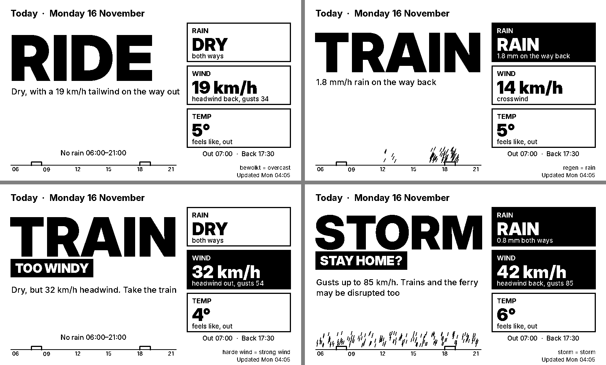

# Cycle or train

An e-ink screen on the hallway shelf that tells you, before you leave at 07:00, whether to cycle from Haarlem to Amsterdam Centraal or take the train.



## How it works

```
 GitHub Actions (twice a day)                         Xteink X4 (wakes 04:00 and 18:00)
 ┌───────────────────────────────┐                   ┌────────────────────────────────┐
 │ 1. Open-Meteo forecast (KNMI) │                   │ 1. join wifi, set clock (NTP)  │
 │ 2. NS trains (optional)       │   GitHub Pages    │ 2. download dashboard.bin      │
 │ 3. apply your rules           │ ─────────────────▶│ 3. draw battery icon           │
 │ 4. draw 800×480 picture       │  dashboard.bin    │ 4. refresh e-ink               │
 │ 5. publish                    │  (48 000 bytes)   │ 5. deep sleep until next slot  │
 └───────────────────────────────┘                   └────────────────────────────────┘
```

**The main idea: the device is dumb.** All the thinking happens on GitHub's computers in Python, which is easy to change. The X4 only downloads a picture and shows it, so you rarely need to reflash it. If you change your rules or the layout, just edit and push.

**Why a `.bin` and not a `.png`?** The screen is 800×480 pixels, and each pixel is black or white: 1 bit. 800 × 480 ÷ 8 = 48 000 bytes, which is exactly the size of the display's framebuffer (its block of screen memory). The server packs the pixels in that same layout, so the device copies the bytes straight in without decoding anything.

| Folder | What it does | Language |
|---|---|---|
| `config.yaml` | Your route, leave times and limits | YAML: you edit this |
| `cot/weather.py` | Gets the hourly forecast at both ends of the route and keeps the worse of the two | Python |
| `cot/decide.py` | Rules: rain, headwind, gusts, cold, ice → verdict | Python |
| `cot/ns.py` | Checks for cancellations and delays on HLM ↔ ASD | Python |
| `cot/render.py` | Draws the screen with Pillow | Python |
| `.github/workflows/publish.yml` | Runs it all on a schedule and publishes to GitHub Pages | YAML |
| `firmware/` | The X4 program | C++ (Arduino / PlatformIO) |

---

## Part 1: Run it on your laptop (15 min)

This step lets you see how the pieces fit before anything goes online. All commands below are for **PowerShell** on Windows.

**Install the tools** (once). `winget` is Windows' built-in installer:

```powershell
winget install -e --id Python.Python.3.12
winget install -e --id Git.Git
```

Close PowerShell and open a new window afterwards, so it picks up the new programs. If typing `python` opens the Microsoft Store, go to *Settings → Apps → Advanced app settings → App execution aliases* and switch off the two "python" entries.

**Allow local scripts** (once). By default Windows blocks the small script that switches Python environments on:

```powershell
Set-ExecutionPolicy -Scope CurrentUser RemoteSigned
```

**Run it:**

```powershell
cd $HOME\Projects\cycle-or-train        # wherever you unzipped it
python -m venv .venv                     # a private Python just for this project
.venv\Scripts\Activate.ps1               # "use that one": (.venv) appears in the prompt; do this in every new window
pip install -r requirements.txt pytest

python -m pytest tests                   # 8 tests should pass
python build.py                          # real forecast → site\
start site\dashboard.png
```

**Try this:** in `config.yaml`, set `max_rain_mm_per_hour` to `0`, run `python build.py` again and watch the verdict change. You can also run the storm test case without internet:

```powershell
python build.py --fixture tests/fixtures/storm.json --now 2026-11-16T04:05
start site\dashboard.png
```

## Part 2: Put it on GitHub (20 min)

1. On github.com, create a **public** repository called `cycle-or-train`. Leave it empty: no README. (Free GitHub Pages needs a public repo. Your wifi password never goes in the repo; see Part 4.)
2. Tell git who you are (once), then push the code:
   ```powershell
   git config --global user.name "Your Name"
   git config --global user.email "you@example.com"

   git init -b main
   git add .
   git commit -m "Cycle or train"
   git remote add origin https://github.com/YOUR-USER/cycle-or-train.git
   git push -u origin main
   ```
   The first push opens a browser window to sign in to GitHub.
3. Go to the repo's **Settings → Pages**. Under *Source*, choose **GitHub Actions**.
4. Open the **Actions** tab. The push already started a run. When it shows a green tick, open `https://YOUR-USER.github.io/cycle-or-train/` to see your dashboard.

**What just happened:** `publish.yml` gave GitHub a recipe: start a Linux machine, install Python, run `build.py`, publish `site/`. The `cron:` lines repeat that recipe on a schedule. GitHub's scheduler can run late, so the file schedules several runs before each wake-up. Each run overwrites the last.

### Optional: NS train check

1. Make an account at [apiportal.ns.nl](https://apiportal.ns.nl), subscribe to the **Ns-App** product and copy your primary key.
2. In the repo, go to **Settings → Secrets and variables → Actions → New repository secret**. Name it `NS_API_KEY` and paste the key.

A *secret* gets passed to the workflow without ever appearing in the code or the logs. With the key set, the screen shows the train status, and if the weather says train but the trains are disrupted, it shows **YOUR CALL**.

## Part 3: Flash the X4 (30–45 min)

> ⚠️ This replaces the reader software. You can always go back: flash CrossPoint or the official firmware again at [xteink.dve.al](https://xteink.dve.al/). Some X4s bought from third-party shops have USB flashing locked. If uploading fails with a "locked" or "secure boot" message, stop and ask.

1. **Install PlatformIO**, the build tool for microcontrollers. With your `(.venv)` active:
   ```powershell
   pip install platformio
   ```
   (Prefer clicking? VS Code with the *PlatformIO IDE* extension does the same through buttons.)
2. **Get the display library.** The FreeInk SDK holds all the X4 hardware knowledge. Add it as a *git submodule*: a pointer to someone else's repo at an exact version.
   ```powershell
   git submodule add https://github.com/Free-Ink/freeink-sdk.git firmware/freeink-sdk
   cd firmware\freeink-sdk; git checkout 6a208c0; cd ..\..
   git commit -am "Add FreeInk SDK"
   ```
3. **Fill in your settings:**
   ```powershell
   Copy-Item firmware\include\secrets.example.h firmware\include\secrets.h
   notepad firmware\include\secrets.h
   ```
   Edit `secrets.h` with your wifi name, password and the `DASHBOARD_URL` from Part 2. `.gitignore` already excludes this file, so it never gets pushed.
4. **Build and upload.** Plug the X4 in with a USB-C *data* cable and press the power button to wake it, then:
   ```powershell
   cd firmware
   pio run                 # compile only (X4 Classic is the default)
   pio run -t upload       # compile + flash; for the original X4 use: pio run -e x4 -t upload
   pio device monitor      # watch the log; Ctrl+C to quit
   ```
   The first build downloads the ESP32 toolchain and takes a few minutes. Windows 10 and 11 recognise the X4 over USB without extra drivers. If upload says it can't find the port, run `pio device list` and send me the output. The log should end with something like `boot=1 wake=power on wifi=1 http=200 bytes=48000`.

**What the firmware does** (`firmware/src/main.cpp`, about 300 lines). It's worth reading, because it's short:
- **The battery latch.** This is the bug from the blog post. Pin GPIO13 switches the battery on. The stock firmware drives it low before sleeping, which cuts the power, so a wake-up timer can never fire. `sleepFor()` keeps it high through deep sleep.
- **Deep sleep.** Between updates the chip is almost completely off and uses microamps. E-ink holds its picture with no power at all, so the screen stays readable while the device sleeps.
- **The power button.** Pressing it wakes the device early. It then shows a status screen for 8 seconds (boot count, battery, wifi signal, server response, next update) before the dashboard.
- **When things fail.** It retries every 20 minutes, up to 3 times. Meanwhile the screen keeps showing the last good picture.

## Part 4: Network hygiene

Your wifi password is compiled into the firmware. If someone took the device, they could get it out. So:
- Put the X4 on your router's **guest network**, with nothing else on it.
- Optional: in the router's settings, reserve a fixed IP for the X4 and set `USE_STATIC_IP 1` in `secrets.h`. It skips asking the router for an address each wake, so the radio is on for less time and the battery lasts longer.

## Tuning

Everything lives in `config.yaml`. Edit it, push, and the next run uses it.

| Setting | Default | Meaning |
|---|---|---|
| `max_rain_mm_per_hour` | 0.2 | Above drizzle = train ("rain makes it train") |
| `max_headwind_kmh` | 25 | Wind *against you*, worked out from the route direction |
| `max_gusts_kmh` | 60 | |
| `storm_gusts_kmh` | 75 | Gusts at or above this show **STORM** (stay home?), whatever else is going on |
| `min_feels_like_c` | -3 | |
| `ice_below_c` | 1 | Any precipitation at or below this = ice risk |
| `leave_evening` | 17:30 | **Set this to your real time** |
| `route_ride` / `route_train` | off | Optional line under the big word |
| `weekend_screen` | true | Non-commute days show DRY / SHOWERS / RAIN for home instead of RIDE / TRAIN |
| `weekend_hours` | [8, 20] | The hours the weekend screen looks at |

Screens: **RIDE**, **TRAIN** (rain, cold or ice), **TRAIN + TOO WINDY** (dry, but wind breaks a limit), **STORM**, **YOUR CALL** (train weather, but the trains are disrupted) and **NO DATA**.

How the rules work: the morning window is 07:00 to 08:00. The forecast is checked at both Haarlem and Centraal, and the worse value counts. Wind is split into the part blowing against your direction of travel. The ferry to NDSM is the same either way, so it isn't part of the decision.

## Ideas for next steps

- **Rain radar for the morning check:** Buienradar gives 5-minute rain forecasts for the next 2 hours. That's more precise for 07:00 than the hourly model. You'd add it to `cot/weather.py`.
- **The NDSM ferry:** show the departure you'd catch at Centraal, using GVB's open data.
- **A "close call" state** when you're just inside a limit.
- **Show the forecast's age** so a stale screen is obvious if updates stop.

## Troubleshooting

| Symptom | Likely cause |
|---|---|
| Status screen says `could not join` | Wrong wifi details, or a 5 GHz-only network (the X4 only does 2.4 GHz) |
| `HTTP 404` | Pages isn't enabled yet, or `DASHBOARD_URL` has a typo |
| Picture is upside down | Set `rotate_180: true` in `config.yaml` and `DISPLAY_ROTATE_180 1` in `secrets.h` |
| Device never wakes on its own | Check the log for `Sleeping … s`. If the battery is very low, the latch can't hold. Charge it. |
| `NO DATA` | The forecast doesn't reach that day yet (Friday evening → Monday). The next update fills it in. |
